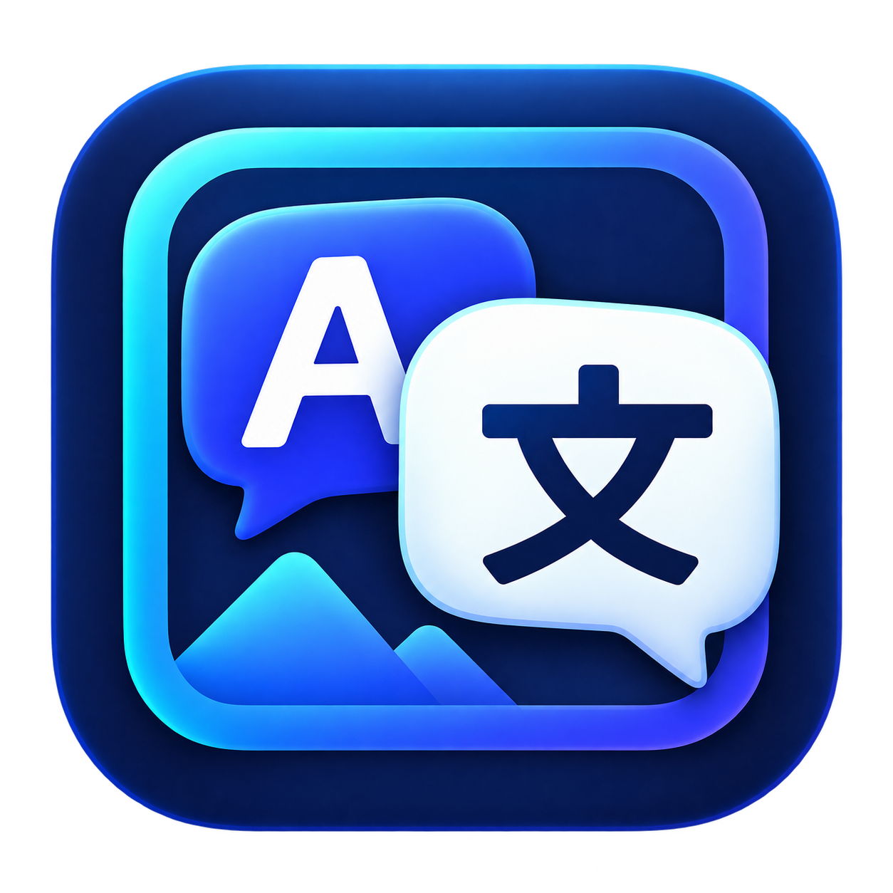
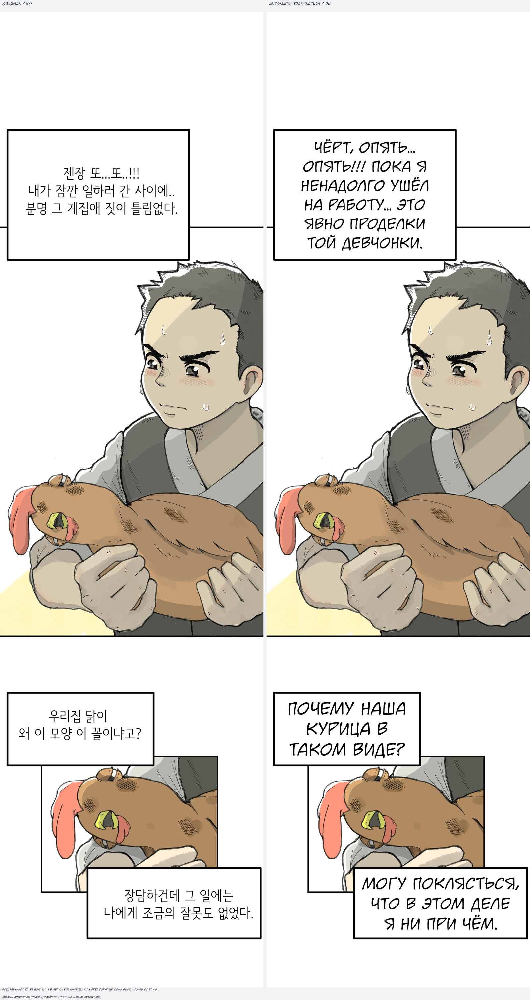
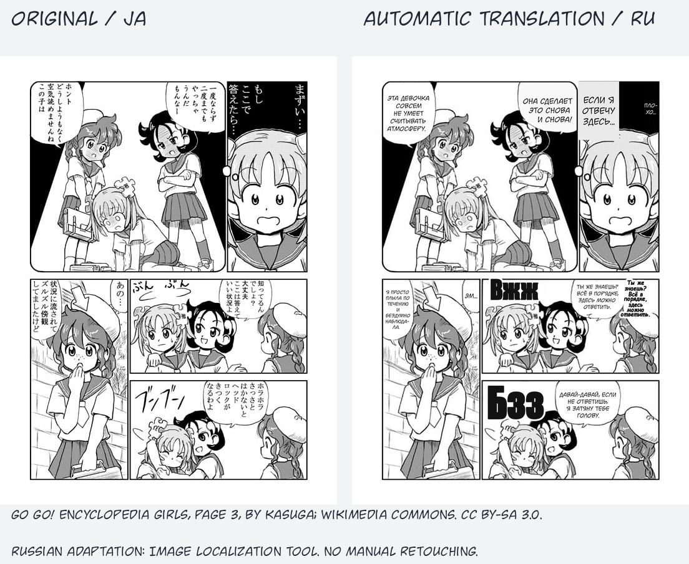
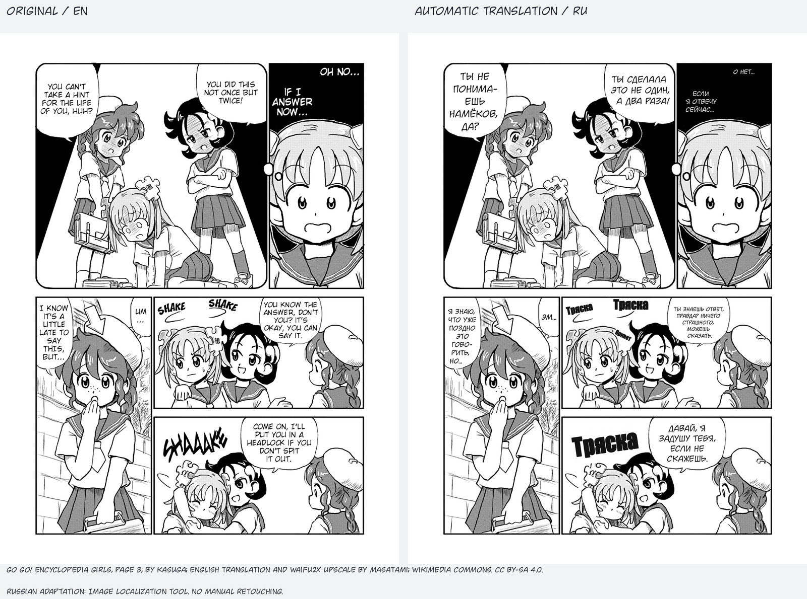
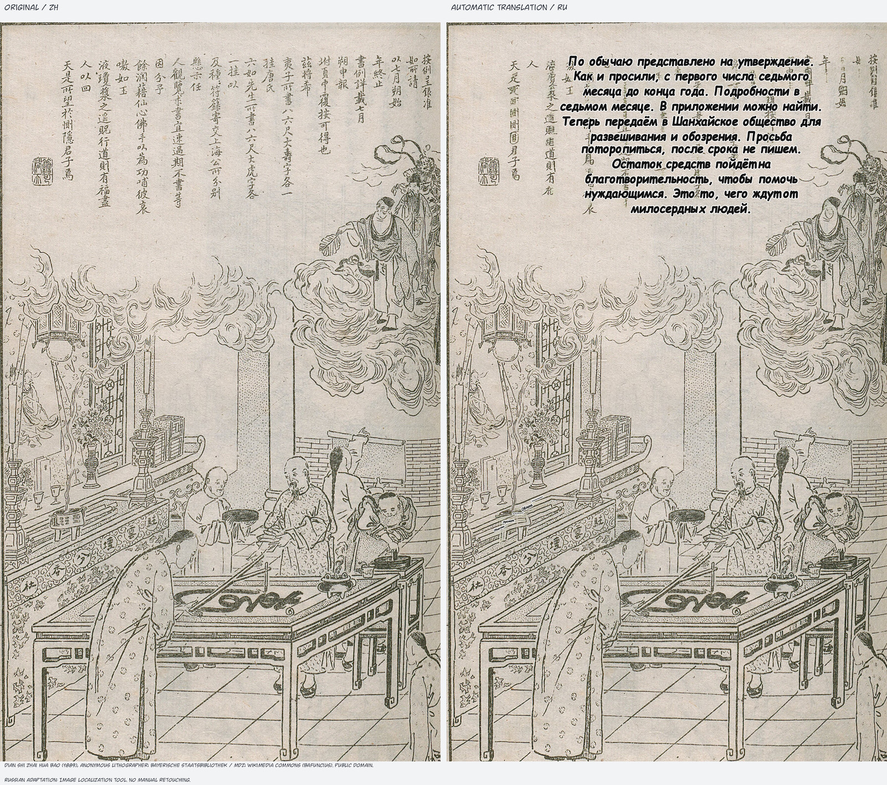
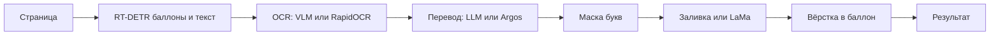

<p align="center">
  
</p>

<h1 align="center">Image Localization Tool</h1>

<p align="center"><strong>Переводите текст. Сохраняйте рисунок.</strong></p>

Локальный перевод текста на изображениях (комиксы, манга, скриншоты): детекция баллонов, OCR и перевод через OpenAI-совместимый LLM, очистка букв, вёрстка перевода в форму баллона.

Качество зависит от страницы и модели. На эталонных прогонах ink recall маски букв был 99.8–100% (см. [docs/BENCHMARK_RESULTS.md](docs/BENCHMARK_RESULTS.md)); на произвольных страницах это не гарантировано. Звуковые эффекты по умолчанию переводятся; отключаются режимом `sfx_mode: skip`. Узкие баллоны переносятся по слогам; текст на скринтоне чистится хуже ровного баллона.

История версий — [CHANGELOG.md](CHANGELOG.md). Заметки к версии 1.0.0 — [docs/RELEASE_NOTES_1.0.0.md](docs/RELEASE_NOTES_1.0.0.md).

## Содержание

- [Установка: Windows, Docker или исходники](#установка)
- [Примеры автоматического перевода](#примеры-автоматического-перевода)
- [Как это работает](#как-это-работает)
- [Требования](#требования)
- [Локальный LLM-сервер](#локальный-llm-сервер)
- [Запуск CLI](#запуск-cli)
- [Окно приложения](#окно-приложения)
- [Сеть (LAN) и расширение браузера](#сеть-lan-и-расширение-браузера)
- [Структура](#структура)
- [Сторонние компоненты](#сторонние-компоненты)
- [Разработка](#разработка)
- [Лицензия](#лицензия)

## Примеры автоматического перевода

**Слева — исходное изображение, справа — результат программы на русском.** OCR, перевод, очистка и вёрстка выполнены автоматически, с включённым переводом SFX. Ручных исправлений текста, масок и оформления нет. Это четыре демонстрационных случая, а не оценка качества на всех изображениях. [Исходники, лицензии и инструкция обновления](docs/examples/README.md); модель, параметры и предупреждения записаны в [отчётах запусков](docs/examples/runs).

<details>
<summary>Корейский → русский</summary>

[](docs/examples/comparisons/korean.jpg)

**동백꽃**, 이호윤 (Lee Ho-yun), по рассказу 김유정 (Kim Yu-jeong). [Источник: 공유마당 / Korea Copyright Commission](https://gongu.copyright.or.kr/gongu/wrt/wrt/view.do?menuNo=200018&wrtSn=13383527), [CC BY 4.0](https://creativecommons.org/licenses/by/4.0/). Показан верхний законченный фрагмент первой длинной ленты; границы обрезки сохранены. Изменения: обрезка, автоматический русский перевод и замена надписей.

</details>

<details>
<summary>Японский → русский</summary>

[](docs/examples/comparisons/japanese.jpg)

**Go Go! Encyclopedia Girls / いけいけ！百科事典娘**, Kasuga, страница 3. [Японский оригинал](https://commons.wikimedia.org/wiki/File:Wikipe-tan_manga_page3.jpg), [CC BY-SA 3.0](https://creativecommons.org/licenses/by-sa/3.0/). Русская адаптация и сравнение распространяются на тех же условиях. **В текущем результате есть дублирование реплики в среднем правом кадре и ошибки перевода; исходник всего 540×720.**

</details>

<details>
<summary>Английский → русский</summary>

[](docs/examples/comparisons/english.jpg)

**Go Go! Encyclopedia Girls**, Kasuga; английский перевод и увеличение waifu2x — Masatami, страница 3. [Английский исходник](https://commons.wikimedia.org/wiki/File:Go_Go!_Encyclopedia_Girls_-_English_03.png), [CC BY-SA 4.0](https://creativecommons.org/licenses/by-sa/4.0/). Русская адаптация и сравнение — CC BY-SA 4.0. **Есть ложная надпись «Привет» около головы персонажа и неточные формулировки перевода.** Английский исходник сам является опубликованным переводом японской манги.

</details>

<details>
<summary>Китайский → русский — сложный исторический пример</summary>

[](docs/examples/comparisons/chinese.jpg)

**點石齋畫報 / Dian shi zhai hua bao**, 1889, том Wu, с. 34; литограф неизвестен. Скан Bayerische Staatsbibliothek / MDZ, загрузка Bafuncius на [Wikimedia Commons](https://commons.wikimedia.org/wiki/File:Literati_in_a_charity_hall_around_a_spirit-writing_(fuji)_table,_with_deities_above._Dian_shi_zhai_hua_bao_(1889).png), общественное достояние. **Это частично неудачный результат: очистка оставила иероглифы, перевод неполный, встречаются ложные распознавания деталей рисунка.** Страница показывает ограничения на старой вертикальной печати; это иллюстрированная пресса, не современная маньхуа.

</details>

Авторы исходных произведений не связаны с проектом; эти примеры не означают их одобрения программы или автоматического перевода. Авторство, изменения и отдельные условия изображений сохранены в [описании набора](docs/examples/README.md) и [манифесте](docs/examples/manifest.json).

## Как это работает



1. **Детектор** (ogkalu RT-DETR-v2 ONNX) находит баллоны и текстовые области.
2. **OCR страницы** через vision-модель на LLM-сервере. Если сервер недоступен — RapidOCR и предупреждение.
3. **Перевод сценария** через LLM (говорящий, род, глоссарий). Фолбэк — Argos на целых блоках.
4. **Маска букв** только у переводимых регионов; однородный фон заливается, остальное чистит LaMa-manga.
5. **Вёрстка** в форму баллона (шрифт Heroika и каталог OFL-шрифтов, перенос через pyphen).

Поддерживаемые форматы страницы: PNG, JPG/JPEG, BMP, TIFF. Прозрачность PNG не сохраняется. Окно дополнительно открывает архивы ZIP, CBZ, CBR, RAR, 7Z и TAR. Браузерный редактор — те же картинки, ZIP/CBZ и проекты `.ilt.zip`.

## Требования

- **Windows portable:** Windows 10/11 x64, доступная на запись папка. Системный Python не требуется. Полный CPU-пакет содержит модели и зависимости; лёгкий ZIP загружает их при подготовке.
- **Docker:** Docker с Compose и поддержкой Linux amd64 контейнеров, современный браузер. Python и модели находятся в образе. На Windows нужна среда Linux-контейнеров; фактическая проверка выполнена на Linux Docker Engine.
- **Из исходников:** Python **3.10–3.13** (на 3.14 возможны проблемы с `torch`). Для окна Windows нужен [Microsoft Edge WebView2 Runtime](https://developer.microsoft.com/microsoft-edge/webview2/).
- **Необязательно:** OpenAI-совместимый сервер с vision-моделью для OCR и LLM-перевода. Полный CPU-профиль работает без него через RapidOCR + Argos, en↔ru. Сам LLM в поставку не входит.
- CUDA доступна как дополнительный компонент desktop-версии. Полные готовые пакеты — CPU, x64; ARM и GPU-образы не поставляются.

## Установка

### Windows: готовое приложение

Выпуск 1.0.0 — [GitHub Releases](https://github.com/Jawerka/image-localization-tool/releases). Windows поставляется только portable ZIP, без установщика. `Source code.zip` — исходники, а не приложение.

- **Полный CPU-пакет:** `ImageLocalizationTool-1.0.0-windows-x64-portable-cpu-full.zip`. Модели и зависимости уже внутри, начальная загрузка не нужна. OCR, очистка и перевод en↔ru работают офлайн.
- **Лёгкий пакет:** `ImageLocalizationTool-1.0.0-windows-x64-portable.zip`. При первом запуске выберите языки и нажмите «Подготовить»; для скачивания компонентов нужен интернет.

Выбирайте файл с суффиксом `cpu-full`, если нужна поставка со всеми моделями.

Распакуйте ZIP целиком и запустите `ImageLocalizationTool/desktop/ImageLocalizationTool.exe`. Оставьте остальные папки рядом с EXE. Настройки, проекты, журнал и ключи находятся в `ImageLocalizationTool/data`; приложение не использует `%APPDATA%` и `%LOCALAPPDATA%`.

Для обновления полного пакета закройте приложение и сохраните старую папку как резервную копию. Распакуйте новую версию в чистую папку по **прежнему пути программы** и перенесите из резервной копии только `data`: так сохранятся абсолютные пути к оригиналам в проектах. Скрипты обновления лёгкого ZIP для полного пакета не подходят. [Подробности поставки и обновления](docs/DISTRIBUTIONS.md).

Лёгкий ZIP обновляется скриптом из нового пакета: [docs/WINDOWS_UPDATE.md](docs/WINDOWS_UPDATE.md). К полному CPU-пакету этот скрипт не применяется. Linux-служба, отдельно от Docker: [docs/LINUX_SERVER.md](docs/LINUX_SERVER.md).

### Docker: приложение в браузере

Распакуйте `ImageLocalizationTool-1.0.0-docker-cpu-full.zip` и откройте терминал в полученной папке:

```sh
docker load -i ImageLocalizationTool-1.0.0-linux-amd64-cpu-full.tar.gz
docker compose up -d --no-build
```

Откройте `http://localhost:8080`. Вход по умолчанию выключен: **Настройки → Доступ**, логин и пароль владельца, **Сохранить доступ**. Учётная запись сохраняется в `data/web-access.json` внутри volume; пароль хранится как хеш. Это одна учётная запись для общего редактора, не отдельные проекты пользователей. [Подробнее о доступе](docs/DISTRIBUTIONS.md#доступ-к-редактору).

Данные сохраняются в Docker volume. `docker compose down` останавливает приложение с сохранением данных; **`docker compose down -v` удаляет данные**. Для LAN, другого порта, резервирования и обновления см. [инструкцию Docker](docs/DISTRIBUTIONS.md#docker-браузерный-редактор).

[compose.ghcr.yaml](compose.ghcr.yaml) указывает образ `ghcr.io/jawerka/image-localization-tool:1.0.0-cpu-full`. Скачайте файл в отдельную папку как `compose.yaml`, затем выполните `docker compose pull` и `docker compose up -d`. При обновлении меняйте тег версии и сохраняйте volume.

Из корня актуальных исходников можно собрать образ самостоятельно (для сборки нужен интернет):

```sh
docker compose build
docker compose up -d
```

### Из исходников

```powershell
python -m venv venv
venv\Scripts\activate
pip install -r requirements-dev.txt
python scripts\setup_models.py
# GPU (CUDA):
python scripts\setup_models.py --torch-cuda
```

Перед оффлайн-обработкой из исходников подготовьте также RapidOCR и языковую
модель: `python -m src.app --deploy all` (набор en→ru). В окне это делает
кнопка «Подготовить приложение»; во время обработки языки не загружаются.

Скрипт скачивает:

| Файл | Куда |
|------|------|
| Детектор ogkalu (int8 ONNX) | `models/` |
| LaMa-manga | `models/anime-manga-big-lama.pt` |
| Шрифт Heroika (OFL), уже в репозитории; скрипт обновляет тот же файл | `src/resources/fonts/` |

Модели в git не входят. Проверка LLM: `python scripts\setup_models.py --llm-url http://127.0.0.1:8080/v1`.

## Локальный LLM-сервер

Нужен эндпоинт OpenAI Chat Completions (`/v1/chat/completions`) и список моделей (`/v1/models`). Для OCR страница уходит как картинка — модель должна поддерживать vision.

Примеры:

**llama.cpp** (`llama-server`, порт по умолчанию 8080):

```powershell
llama-server -m path\to\vision-model.gguf --port 8080
```

**LM Studio** — включить Local Server, взять URL вида `http://127.0.0.1:1234/v1`.

**Ollama** — OpenAI-совместимый прокси (часто `http://127.0.0.1:11434/v1`) и vision-модель.

Где задать адрес:

| Режим | Настройка |
|-------|-----------|
| CLI | `config.json` → `llm_base_url`, или флаг `--llm-url` |
| Окно | Настройки → адрес LLM. По умолчанию пусто |
| Ключ API (окно) | В окне через «секрет»; хранится в `data/llm-api-key.txt`, в JSON не пишется |
| Ключ API (CLI) | Флаг `--llm-api-key`, переменная `ILT_LLM_API_KEY`, или `llm_api_key` в `config.json` вручную (команда его туда не пишет) |

Ключ уходит в заголовке `Authorization: Bearer` на заданный `llm_base_url` — и в `/v1/models`, и в `/v1/chat/completions`. Перед вводом ключа проверьте адрес. «Проверить» с заданным ключом шлёт ещё и минимальный запрос `chat/completions` (`max_tokens: 1`), чтобы отличить неверный ключ от публичного списка моделей.

Пример `config.json` (CLI читает его из текущего каталога или по `--config` и сам файл не создаёт; в git не входит):

```json
{
  "source_lang": "en",
  "target_lang": "ru",
  "llm_base_url": "http://127.0.0.1:8080/v1",
  "llm_model": "",
  "ocr_backend": "vlm",
  "translator_backend": "llm",
  "inpainter_backend": "lama",
  "reading_order": "auto",
  "sfx_mode": "replace",
  "device": "auto"
}
```

Пустой `llm_model` берётся из `/v1/models`.

## Запуск CLI

```powershell
python src\main.py page.png out.png --source-lang en --target-lang ru
python src\main.py page.png out.png --llm-url http://127.0.0.1:8080/v1 --debug-dir output\page
python src\main.py chapter\ output\translated --recursive --skip-existing
```

Полезные флаги: `--config`, `--min-confidence`, `--llm-think`, `--ocr vlm|rapid`, `--translator llm|argos`, `--inpainter lama|opencv`, `--reading-order auto|ltr|rtl`, `--translate-sfx` / `--no-translate-sfx`, `--glossary names.json`, `--rerender regions.json`, `--recursive`, `--skip-existing`. `--verbose` разбирается и на прогон не влияет.

Оценка на своих эталонах (папка с `page.ext` + `page-mask.ext`):

```powershell
python scripts\eval_pipeline.py --images path\to\pages
```

## Окно приложения

Готовое приложение — Flutter-хост: он запускает замороженный Python-сайдкар. Из исходников те же экраны поднимаются так:

```powershell
python -m src.app
python -m src.app --browser
python -m src.app page.png папка
```

Без флага открывается окно (pywebview + WebView2). `--browser` поднимает тот же локальный HTTP на `127.0.0.1` и открывает системный браузер. Повторный запуск передаёт пути уже открытому экземпляру.

Данные:

| Режим | Где |
|-------|-----|
| Данные и состояние | `<папка приложения>\data` (из исходников — `data/` в корне репозитория) |
| Кэш загрузок | `<папка приложения>\.downloads` |
| Явный override данных | `ILT_DATA_DIR` |

`%APPDATA%\ImageLocalizationTool` и `%LOCALAPPDATA%\ImageLocalizationTool` больше
не используются. Старые данные там не переносятся автоматически — скопируйте
их в `data/` вручную. Папка приложения должна быть доступна на запись.

Подробности API, SSE, горячих клавиш и хранения проектов: [docs/APP.md](docs/APP.md).

## Сеть (LAN) и расширение браузера

Удалённый API для расширения — отдельный слушатель, по умолчанию выключен. В desktop-режиме локальный интерфейс слушает только `127.0.0.1`. Docker с браузерным редактором — отдельный режим `--server`, описанный в [установке](#docker-приложение-в-браузере); его авторизация отличается от сопряжения расширения.

```powershell
python -m src.app --headless --remote
```

- LAN API: `remote_bind` / `remote_port` (по умолчанию `0.0.0.0:8765`), маршруты `/v1/...`.
- Локальный код сопряжения: `127.0.0.1:8766`, токен сессии в `data/session.token`.
- Сопряжение: код из 6 цифр → `POST /v1/pair` → Bearer-токен устройству.
- Трафик в LAN — обычный HTTP без TLS. Брандмауэр Windows может блокировать входящие, пока не разрешите порт в частной сети.

Расширение (Chromium / Firefox):

```powershell
python scripts\build-extension.py
```

Загрузить `dist/chromium` или `dist/firefox` как распакованное дополнение. Настройки: URL сервера и код сопряжения. Описание: [docs/EXTENSION.md](docs/EXTENSION.md).

Для перевода нажмите ПКМ на картинке → «Перевести изображение», наведите на неё и нажмите появившуюся кнопку, либо значок расширения → «Выбрать изображение вручную», затем нажмите на картинку. Перевод появится прямо на её месте, без боковой панели. Повторное наведение открывает мини-панель: «Сравнить», «Копировать», «Перевести заново», «Убрать». Доступ ко всем сайтам и серверу расширение запрашивает один раз при установке, а не для каждой картинки. Подробности — [docs/EXTENSION.md](docs/EXTENSION.md). После обновления unpacked-расширения нажмите «Перезагрузить» на странице расширений и обновите вкладки сайта.

## Структура

```
apps/desktop/        Flutter-хост готового приложения
src/app/             Окно, HTTP API, LAN, воркер
src/main.py          CLI
src/page_pipeline.py Пайплайн
src/components/      Детектор, OCR, перевод, маска, LaMa, вёрстка
src/utils/           Клиент LLM, пути установки, метрики маски
web/                 Интерфейс окна и браузерного редактора
extension/           Расширение Chromium и Firefox
scripts/             Модели, оценка, сборка, релиз
docs/                APP, EXTENSION, DISTRIBUTIONS, FONTS, ROADMAP, LINUX_SERVER, WINDOWS_UPDATE
deploy/              Юнит systemd для Linux-службы
locks/               Зафиксированные колёса рантайма
assets/              Колесо Argos и его провенанс
specs/               Базовая спецификация specs/001-current-state
tests/               Python, JavaScript, сценарии Linux и Windows
.github/workflows/   CI, релиз, Docker
Dockerfile           Образ браузерного редактора
```

`legacy/` в корне — локальный архив старых файлов. В git она не входит.

## Сторонние компоненты

| Компонент | Источник | Лицензия / заметка |
|-----------|----------|-------------------|
| Детектор ogkalu | [Hugging Face](https://huggingface.co/ogkalu/comic-text-and-bubble-detector) | скачивается отдельно |
| comic-text-detector | релиз manga-image-translator beta-0.3 | необязательный второй детектор, GPL-3.0 |
| LaMa-manga | [Sanster/models](https://github.com/Sanster/models) | скачивается отдельно |
| RapidOCR, PyTorch | PyPI и PyTorch CDN | OCR-фолбэк и очистка; в полном CPU-пакете уже внутри |
| Heroika и OFL-шрифты | OFL 1.1 | лежат в `src/resources/fonts/` и каталоге шрифтов |
| CC0 comic-проба (GGBotNet) | CC0 1.0 | см. [docs/FONTS.md](docs/FONTS.md); файлы и `CC0.txt` в `src/resources/fonts/` |
| Argos Translate | фиксированное колесо, MIT, провенанс в `assets/README.md` | офлайн-фолбэк перевода |
| 7-Zip | в полном Windows-пакете, каталог `tools/7zip` | распаковка RAR/CBR |

## Разработка

Сборка Windows, тесты, деплой и соглашения — в [CONTRIBUTING.md](CONTRIBUTING.md). Текущее состояние продукта — в [specs/001-current-state/spec.md](specs/001-current-state/spec.md).

## Лицензия

MIT — см. [LICENSE](LICENSE).
