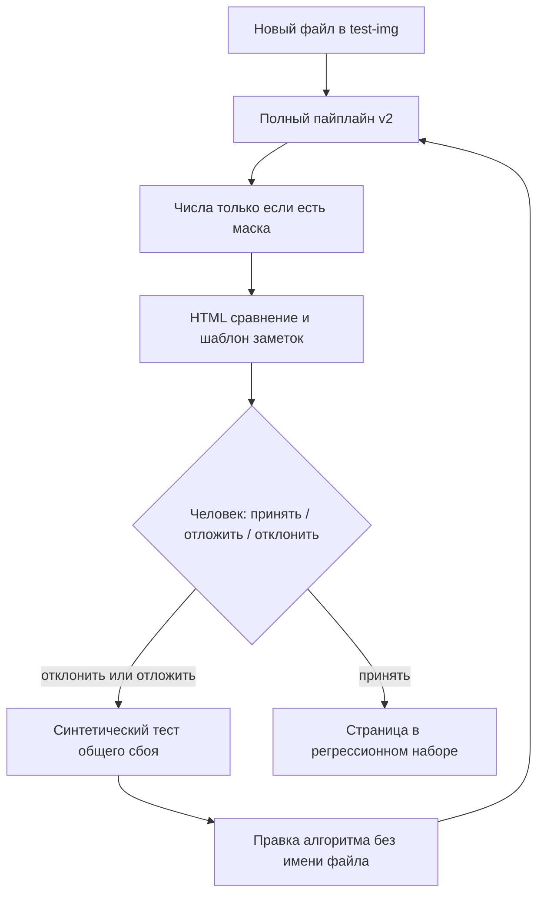

# Приёмка алгоритмов и новых страниц

Регламент, чтобы новое изображение и новое изменение детекции, OCR, маски или вёрстки проходили один и тот же путь: прогон → числа → визуальный осмотр → **явное «принято» человеком**. Пока человек не подписал страницу, она не считается исправленной и не входит в регрессионный набор.

Это процесс оценки, не обещание качества на произвольных страницах. Число ink recall относится только к прогнанным кадрам; см. [BENCHMARK_RESULTS.md](BENCHMARK_RESULTS.md) и принцип V конституции.

Связанные отчёты сеансов: [NEW_PAGE_ALGORITHMS.md](NEW_PAGE_ALGORITHMS.md), [AUTOMATIC_RETOUCH.md](AUTOMATIC_RETOUCH.md). Набор поставки 1.0 — [EVAL_SET.md](EVAL_SET.md); он не подменяет этот регламент.

## Зачем отдельный регламент

Прогон 012 (`remaining_page_quality`) показал, где ломается «просто прогнать картинки»:

- Оценщик RapidOCR и визуальный прогон VLM смешивались в одном выводе. Recall 62% и «фраза склеилась» — разные утверждения.
- Одноразовый скрипт в `output/` каждый раз собирался заново.
- Страница объявлялась лучше по одной метрике, хотя на сравнении оставались буквы.
- Новые кадры без маски некуда было деть, кроме устного «выглядит нормально».

Этот документ фиксирует ворота, чтобы следующее изображение из `test-img/` шло тем же маршрутом.



Два входа сходятся в одни ворота:

| Вход | Что запускается | Что нельзя |
|---|---|---|
| **A. Новое изображение** | полный v2 на этом файле | править алгоритм «под эту картинку» |
| **B. Новое изменение алгоритма** | синтетические тесты, затем прогон **уже принятых** страниц | объявлять успех без визуального осмотра и подписи |

## Жёсткие правила

1. Вход только PagePipeline v2. Новый детектор — новый файл в `src/components/`, новая настройка — поле `Config` с умолчанием.
2. В алгоритмах нет имён файлов, эталонных координат и ручных переводов. Маски `*_mask` / `*-mask` открывает **только оценщик после** обработки.
3. Ручные стили, `manual` / `edited` и `layout_snapshot` не пересчитываются.
4. `min_font_size` (по умолчанию 10) и `text_scale` (по умолчанию 1.1) в этом регламенте не снижаются. Невлезание — полный текст плюс overflow, без обрезки.
5. Метрики и визуальный осмотр не подменяют друг друга. Ink recall не есть «текст удалён». Residue/halo на цветном фоне могут считать восстановленный рисунок остатком.
6. Движок прогона и движок оценки записываются отдельно. Нельзя сложить recall RapidOCR и скрин VLM в одну фразу «страница исправлена».
7. Страница с видимыми исходными буквами, пропущенной репликой или разрезанной фразой **не принимается целиком**, даже если одна метрика выросла.
8. Деплой, публикация и слияние в `main` в этот регламент не входят. Их заказывают отдельно.

## Режим A — новое изображение

Когда файл появляется в локальном `test-img/` (в git не входит).

### 1. Кладём исходник

- Картинка: `test-img/<stem>.png` (или `.jpg` / `.webp`).
- Маска букв по желанию, тем же stem: `test-img/<stem>_mask.png` или `<stem>-mask.png`. Без маски страница идёт только на визуальную приёмку.
- Необязательная зона баллонов: `<stem>-mask-2.png` — для метрики damage, не вторая пара.
- В алгоритмы маска не передаётся.

Запись в локальный реестр `test-img/intake-registry.json` (тоже не в git):

```json
{
  "stem": "97404",
  "file": "97404.jpg",
  "sha256": "<хеш исходника>",
  "has_mask": true,
  "added": "2026-11-07",
  "status": "pending",
  "engines": {"ocr": "vlm", "translator": "llm"}
}
```

`status`: `pending` → после прогона `reviewed` → после подписи `accepted` / `deferred` / `rejected`.

Для приёмки из `test-img/` штатный путь — VLM OCR и LLM-перевод на тестовом сервере разработки `http://192.168.88.37:8989/v1` (модель из `/v1/models`, обычно `qwen36-27b-mtp-q6k-2x5060ti`). Обращение к этому серверу с локальными тестовыми кадрами и распознанным текстом **разрешено постоянно**: это стенд разработки, не публикация. Если сервер недоступен, в отчёте пишется фолбэк RapidOCR/Argos или технический «ТЕСТ». Полный перевод и технический текст в одном HTML не смешивать.

### 2. Полный прогон, всегда один и тот же

Каталог отчёта новый, существующий не перезаписывать. Штатная команда набора:

```powershell
venv\Scripts\python.exe scripts\eval_intake.py --out output\intake-YYYYMMDD --ocr vlm --translator llm
```

Драйвер берёт исходники из `test-img/` и `test-img/sound-ref/`, пропускает html, компаньоны `*_mask`/`*-mask` и jpg-миниатюру рядом с PNG. Для каждой страницы вызывается `PagePipeline.process` (min 10, scale 1.1, SFX replace). Ручная маска в пайплайн не передаётся. Для каждой страницы обязательны:

| Файл | Зачем |
|---|---|
| `original` (копия исходника) | левая сторона сравнения |
| `clean.png` | очистка без перевода |
| `mask.png` | что реально ушло в LaMa |
| `result.png` | перевод и вёрстка |
| `markup.jpg` | рамки и номера регионов |
| `comparison.jpg` | оригинал \| результат |
| `regions.json` | текст, перевод, кегль, overflow, движки |

Индекс набора — `$out/index.html`. Шаблон заметок — `$out/visual-notes.json` (сразу со статусом `pending` по каждому stem).

Не брать кэш чужого OCR «чтобы быстрее», если цель — приёмка нового кадра. Кэш переводов допустим только в режиме B, когда регионы не склеивались и человек уже принял прошлый текст.

### 3. Числа — по автомаске полного прогона

`eval_intake.py` после очистки открывает эталон и считает `page_quality` против `03_mask.png` того же прогона. Отдельный `eval_retouch.py` для этой приёмки не нужен: он строит другие регионы (детектор ± RapidOCR). `--ocr rapid` остаётся отдельным замером RapidOCR и не подставляется как оценка VLM-страницы.

Смотреть: ink recall, residue, spill, halo, damage. Цель на новом кадре — не «99.8% как эталон букв», а честная фиксация. Нет падения относительно собственного предыдущего прогона той же страницы и тех же регионов.

Страницы без маски в `eval.json` не попадают. В `visual-notes.json` у них `"eval": null`.

### 4. Визуальный чеклист

Для **каждой** страницы, по сравнению оригинал/результат и по `markup.jpg`:

1. Остались ли исходные буквы или цветная обводка.
2. Пропущены ли реплики, SFX, свободные подписи (стилизованный фон тоже считается).
3. Разрезана ли одна фраза на несколько блоков.
4. Переполнение и кегль: не ниже `min_font_size`; overflow допустим, обрезка текста — нет.
5. Заливка и обводка на тёмном и цветном фоне читаемы.
6. Съеден ли рисунок вокруг текста.

Заметка описывает **общий сбой режима** («наклонная фраза режется по AABB», «циановая обводка на текстуре не в маске»), а не «починить 3038661». Имя файла в заметке — указатель на пример, не ключ правила.

### 5. Ворота человека

Агент останавливается. Человек ставит одно из трёх:

| Решение | Когда | Что дальше |
|---|---|---|
| **Принято** | чеклист без блокирующих пунктов; числа не противоречат картинке | `status=accepted`, страница входит в регрессию режима B |
| **Отложено** | сбой виден, но чинить сейчас не будем; ограничение записано | `status=deferred`, в отчёте явное «не исправлено целиком» |
| **Отклонено** | блокирующий сбой, который считаем общим | `status=rejected` → синтетический тест → правка алгоритма → снова с шага 2 |

Подпись — файл `$out/acceptance.json` (или поля в реестре). Пока файла нет, набор `pending`. Агент не пишет `accepted` за человека.

Пример:

```json
{
  "stem": "3038661",
  "decision": "deferred",
  "by": "operator",
  "date": "2026-11-07",
  "blockers": ["цветная обводка на текстуре остаётся"],
  "notes": "склейка OH MY WHATS THIS принята как частный успех; страница целиком нет"
}
```

## Режим B — изменение алгоритма

Когда меняется детекция, OCR-сборка, маска, очистка или вёрстка.

### 1. Сначала синтетика, потом картинки

Регрессия в `tests/unit/` на **общий** случай: обводка на шуме, два наклонных AABB одной фразы, три неназначенных слова на линии, сжатие интервалов при кегле 10, узкий баллон с русским остаётся горизонтальным. Тест не открывает `test-img/` и не знает stem.

Целевой pytest затронутых модулей должен пройти до прогона страниц.

### 2. Baseline на принятых парах

До правки, если его ещё нет для этой ветки:

```powershell
venv\Scripts\python.exe scripts\eval_retouch.py --out output/<change>/baseline --ocr none --only <принятые stems с маской>
```

После правки — новый `--out`, `--baseline` предыдущего. Каталог не перезаписывать. Нет падения ink recall на тех же регионах. Рост residue/spill без просмотра сравнения — блокер.

Список `--only` берётся из реестра (`status=accepted` и `has_mask`). Не раздувать прогон на всю галерею «на всякий случай» и не подмешивать `pending`.

Отложенные страницы можно прогнать отдельно как контроль известного ограничения, но их числа не объявлять успехом изменения.

### 3. Визуальный повтор

На затронутых принятых страницах и на любом новом кадре из режима A: тот же HTML и тот же чеклист. Если картинка изменилась — снова ворота человека, даже при росте recall.

Точечная правка кода — только если сбой воспроизводится синтетически или на нескольких страницах. Одна картинка не даёт права на особое правило.

## Что считать блокером

Блокер приёмки страницы:

- читаемые исходные буквы или цветной ореол на результате;
- пропущенная реплика / SFX / свободная надпись, которая есть на оригинале;
- одна фраза разрезана на блоки с разным смыслом;
- кегль на итоговом растре ниже `min_font_size`;
- перевод обрезан, чтобы влезть;
- явная порча рисунка вокруг текста (не путать с LaMa-сглаживанием фона под буквами).

Не блокер сами по себе:

- предупреждение overflow при полном тексте и кегле ≥ минимума;
- residue/halo без видимых букв на цветном или glow-фоне;
- логотип издателя и колонтитул, если их не считаем репликой;
- известное отложенное ограничение, уже записанное в отчёте.

## Движки и как их не путать

| Вопрос | Чем мерить |
|---|---|
| Склейка / порядок строк RapidOCR | синтетика + `--ocr rapid` |
| Маска при уже найденных регионах | `--ocr none` на сохранённых регионах |
| Новый кадр «как в приложении» | полный v2, обычно VLM+LLM |
| Вёрстка min 10, вертикальный русский | синтетика + визуально на результате полного прогона |

В `regions.json` и в отчёте всегда есть `ocr_engine` и `translator_engine`. HTML-заголовок страницы повторяет их.

## Команды-шпаргалка

Набор приёмки (все исходники, эталон только после автомаски):

```powershell
venv\Scripts\python.exe scripts\eval_intake.py --out output\intake-YYYYMMDD --ocr vlm --translator llm
```

Численная ретушь принятых пар после изменения маски:

```powershell
venv\Scripts\python.exe scripts\eval_retouch.py --out output/change/baseline --ocr none --only 01-- 3923712 97404
venv\Scripts\python.exe scripts\eval_retouch.py --out output/change/after --baseline output/change/baseline --ocr none --only 01-- 3923712 97404
```

Целевые тесты типового изменения 012:

```powershell
venv\Scripts\python.exe -m pytest tests/unit/test_retouch_ink.py tests/unit/test_text_regions.py tests/unit/test_rapid_ocr_guess_type.py tests/unit/test_typesetter.py tests/unit/test_readable_layout.py tests/unit/test_adaptive_text.py tests/integration/test_page_pipeline.py -q
```

## Артефакты, которые не коммитятся

`test-img/`, `output/`, `intake-registry.json`, `visual-notes.json`, `acceptance.json`, `eval.json`. В репозиторий попадает только этот регламент, синтетические тесты и ограничения в `docs/`.

После подписи человека ограничения принятых и отложенных страниц кратко дописываются в [NEW_PAGE_ALGORITHMS.md](NEW_PAGE_ALGORITHMS.md) или в отчёт фичи: что принято, что отложено, какие числа к какому движку относятся.

## Чего этот пайплайн не делает

- Не делает качество на новых кадрах равным эталону букв 99.8%.
- Не заменяет holdout поставки из [EVAL_SET.md](EVAL_SET.md).
- Не разрешает деплой. После приёмки алгоритма деплой — отдельный запрос и [DEPLOYMENT_SAFETY.md](DEPLOYMENT_SAFETY.md).
- Не добавляет отдельную модель вертикальных японских колонок: только порядок RapidOCR и отказ от ложной вертикальной вёрстки русского.
